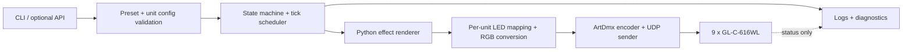

# Raspberry Pi LED Backend Implementation Plan（規劃草案）

> 歷史文件：P0–P4／live／WLED HTTP／部署設計已由最小化 Art-Net backend 取代。現行實作請見 [backend README](../README.md)。

狀態：P0–P2 已通過開發主機驗證；P3 scheduler、diagnostics CLI 與 release smoke 已實作，60 秒量測通過，一小時長跑依使用者要求提前停止。P4 單機 live profile、WLED identity/fallback、STOPPED-by-default 本機服務、固定 tag installer/systemd 已建立並通過離線假節點／本機準備測試。尚未取得實機盤點資料，因此 Pi 安裝、封包輸出、映射、timeout、升級與回退的實機驗收仍未完成。

## 1. 目標與邊界

- 一台 Raspberry Pi 5 2GB 以 40 FPS 產生 9 組 LED 畫面，透過有線網路單播 ArtDmx 到每組的 GL-C-616WL/WLED。
- 每個半圓有 156 顆燈，兩個半圓接收相同的像素訊號；144 LED/m 是燈帶密度，不是每個半圓的燈數。已知燈帶為 12V RGB、標稱 WS2812，WLED v0.15.3。Backend 每組只產生一份 156 像素 frame，與現有前端模擬器的 ledCount 一致；P4 再核對確切 IC、每顆是否可單獨定址，以及訊號如何分配至兩個半圓。
- 後端使用前端 EffectPreset v2（effectId、numeric parameters、solid/gradient color）產生同一個 logical frame 的各 unit 像素。
- SAMD21 持續獨立負責 motor power、relay、PWM 與安全狀態。後端不直接操作 relay 或 motor GPIO。
- 第一版只驗收無硬體 dry-run、Python renderer 與 ArtDmx 封包驗證；接實機、前端遠端控制與正式部署屬後續階段。不承諾機械相位鎖定或清晰 POV 圖形。

## 2. 待確認決策

| 決策 | 暫定做法 | 定案所需資料 |
| --- | --- | --- |
| 第一版驗收範圍 | **已確認：**無硬體 dry-run 與 ArtDmx packet capture；1/3/9 台接入列後續階段 | 無 |
| 後端語言 | **已確認：**Python 3.12，以 uv 管理；獨立 renderer 與前端 golden vectors 對照 | P1 已鎖定版本 |
| 操作介面 | **已確認：**第一版只做本機 config/CLI/diagnostics | 無 |
| 發布來源 | **已確認：**固定 backend tag 的 GitHub Release；Pi 不追蹤開發分支 | P4 確認 repository 可見性、Pi 到 GitHub/package source 的路徑與憑證需求 |
| 升級後播放 | **已確認：**升級前若為 PLAYING，健康檢查通過後自動恢復原 preset；原為 STOPPED 則保持 STOPPED | P4 定案健康檢查 timeout 與失敗回退演練 |
| LED 格式 | **已確認：**12V RGB、標稱 WS2812、144 LED/m、每半圓 156 燈；RGBW 不列入第一版 | 確切 IC/資料表、156 燈是否為 156 可定址像素、色序 |
| 實體像素映射 | **已確認：**兩個半圓吃相同訊號；dry-run 每組只輸出一份 156 像素 frame | 訊號是實體分岔或 WLED 雙輸出鏡像、兩條的 index 方向與 GPIO 接法，P4 實測 |
| 網路位址 | 9 台固定 DHCP reservation 或 static IP，ArtDmx unicast | IP/MAC/WLED 版本與交換器設定 |
| 串流失聯後燈狀態 | **已確認：**恢復 WLED 本地效果；受控停止先釋放 realtime，程序死亡依賴 timeout | 依使用者決定，P4 才選本地 preset ID/亮度與 timeout，並實機驗證 |
| `world-upper-half` | **已確認：**標為 open-loop 實驗效果，不承諾真實對準 | 無 |
| motor telemetry | 第一版不依賴；未來獨立 adapter 接 SAMD21/感測器 | 傳輸方式與資料格式 |

以上暫定值只讓工作可以切分，不應被當成已確認的硬體事實。

## 3. 資料流與模組



建議模組職責：

- `backend/moon_observe_backend/effects.py`：Python 獨立實作現有七個效果與 v2 色彩規則；以從 frontend 產生的 golden vectors 驗證，不共用執行時程式碼。
- `backend/moon_observe_backend/config.py`：P0 dry-run schema 驗證、9 組虛擬 inventory、156 邏輯像素與單 universe map；拒絕重複 Port-Address。亮度上限、真實網路位址與訊號拓撲留到 P4 記錄。
- `backend/moon_observe_backend/renderer.py`：輸入 validated preset、global frame、unit；輸出標準化 RGB frame 與 byte 量化。保留 `globalControllerFrame` 與 per-unit `controllerFrame` 的差別。
- `renderer.rgb_bytes`：每組將一份 156 像素 frame 量化成 RGB channel；兩個半圓共用這份資料，不在 ArtDmx payload 複製第二份。P4 再確認硬體分岔或 WLED 鏡像輸出、實體 index 方向與色序；ArtDmx channel order 保持 RGB。
- `backend/moon_observe_backend/artnet.py`：以 `stupidartnet==1.6.0` 建立 ArtDmx 封包，並保留 decode、universe 分段、sequence、離線 pcap 與 127.0.0.1 fake node；UDP/6454 對實體 WLED 單播留到 P4。ArtSync 不作為第一版依賴。
- `backend/moon_observe_backend/runtime.py`：使用高解析度單調時鐘及絕對 25 ms deadline；每 tick 先產生全部畫面，再送出封包。dry-run 送到 127.0.0.1 fake node；P4 單機 live 使用同一排程器並在影格邊界取新的 preset，記錄 deadline lateness、batch send span 與漏影格。
- `backend/moon_observe_backend/live.py` / `service.py`：P4 的 live 設定與 WLED 身分比對、實體 ArtDmx 單播、受控停止與本地 Unix socket 控制。服務開機為 STOPPED；目前只允許一台已確認映射的控制器。
- `backend/diagnostics`：時序、封包與 node 狀態；不能把 UDP `send` 成功當作 LED 已顯示。
- `backend/moon_observe_backend/cli.py`：提供本機 `validate`、`render-frame`、`inspect-packets`、`verify-loopback`、連續 `dry-run` 與讀取已完成 summary 的 `status`。若未來需前端操控，另加受保護的 HTTP API。

### Python 專案與測試資料佈局（P0–P2 已建立）

```text
backend/
├── .python-version
├── pyproject.toml
├── uv.lock
├── config.example.json
├── preset.example.json
├── run.py
├── moon_observe_backend/
│   ├── config.py
│   ├── effects.py
│   ├── renderer.py
│   ├── artnet.py
│   └── cli.py
├── fixtures/effects_v2.json
└── tests/
frontend/scripts/generateBackendVectors.ts
```

P0–P4 軟體使用 Python 3.12、uv project、標準函式庫與 `stupidartnet==1.6.0`，`[tool.uv] package = false` 讓 CLI 直接從 source tree 啟動。以 `uv run --locked --project backend python backend/run.py` 執行 CLI，`uv.lock` 進版控。Golden fixture 由 frontend 的純效果函式生成後進版控；Python 測試只讀該資料，避免兩邊共用同一個錯誤實作。

現有 fixture 覆蓋七個效果、純色與 2/5/8 色 gradient、兩種 gradient axis、156 LED、0/1/3/4/19/20/100/800 影格、unit 0/8、隨機效果的 seed/hold 邊界，以及 `world-upper-half` 的正/零/負高度；包含 252 個取樣向量及 392 個 156 像素完整影格 SHA-256。Packet 測試驗證 156 像素封包與 170/171 像素 universe 容量邊界、header、length、sequence wrap、末尾補零、loopback fake node 和離線 pcap。

### 設定格式草案

Backend config 使用獨立的 `configVersion`，不與 EffectPreset 的 `schemaVersion: 2` 混用。Preset 驗證會檢查 effectId、參數範圍、有限且位於 0–1 的 RGB 分量、gradient 的 2–8 個色點及合法 axis。可直接執行的完整九組設定見 [config.example.json](../config.example.json)，預設 preset 見 [preset.example.json](../preset.example.json)。下列是其中一組的欄位片段：

```json
{
  "unitId": 1,
  "firstUniverse": 1,
  "dmxStartAddress": 1,
  "format": "RGB",
  "frameOffset": 0,
  "logicalPixelCount": 156,
  "physicalArcCount": 2,
  "signalMode": "shared",
  "virtualPhaseRadians": 0
}
```

完整 dry-run config 另有 `configVersion: 1`、`controllerFps: 40`、`nominalRpm: 360`，並列出 9 組虛擬 unit；沒有真實 IP/MAC，且驗證器拒絕 `ip` 欄位。P2 僅在本機 loopback 傳送到 fake node，或輸出 packet capture 檔，不連接實體網路。現有驗證器檢查 ID 1–9 唯一、Port-Address 不重複、每組 156 RGB 邏輯像素、兩半圓共用訊號及非負整數 frame offset。P4 才新增 live profile，要求真實 IP/MAC、WLED exact build、可定址像素數與實體拓撲，缺項時拒絕送實體封包。

## 4. 效果與時間契約

1. session 開始時固定 monotonic `t0`；logical tick `n` 的 deadline 是 `t0 + n × 25 ms`。效果只讀整數 frame，不讀 wall-clock 渲染時間。
2. 每 tick 先生成 9 組像素，再依固定 unit/universe 順序送出。每組 frame offset 以 `controllerFrame = globalFrame + offsetFrames` 表示；`globalControllerFrame` 保持相同，供「逐月」跨 unit 編排。
3. 如果超過下一個 deadline，不補送過期影格，也不連續爆發封包；記錄 missed tick，跳到應送的最新 frame。preset 更新只在 tick 邊界生效，並回報生效的 tick/revision。
4. 所有可調效果與色彩用前端 EffectPreset v2 的 golden vectors 驗證。Fixture 以實際半圓的 ledCount=156 為主；隨機亮點的 JS 32-bit integer/Math.imul、gradient 插值與 RGB clamp 都須逐項定義，避免 Python 語意差異。浮點 golden vectors 以嚴格容差比較；封包位元組以 `floor(clamp01(x) × 255 + 0.5)` 量化後逐位元組一致（避免 Python `round` 的 ties-to-even 差異）。
5. `world-upper-half` 的 simulator 依假設起始相位及名義 RPM 估算 `unitRelativeY`；P2 renderer 以設定中的 `virtualPhaseRadians` 和第一個半圓的幾何作可重現估算。兩個半圓共用訊號，無法分別依各自空間位置點燈；無 index sensor 時也無法保證真實空間上半部。若需真正對準，須另開感測器/同步與接線設計。
6. 第一版僅 RGB；WS2812 的確切 IC 與 12V 驅動結構須依燈帶標籤/資料表核對。144 LED/m 是密度，不能用作 ledCount；P4 必須確認 156 顆實體燈是否對應 156 個可定址像素。

### 像素與 universe 預算

| 每組邏輯像素 | 模式 | 每 universe 完整像素上限 | 每組 universes | 9 組、40 FPS ArtDmx |
| ---: | --- | ---: | ---: | ---: |
| 156（兩個半圓共用） | RGB | 170 | 1 | 360 packets/s |

以每燈可單獨定址、WLED `Multi RGB`、DMX 起始地址 1 為 dry-run 假設。每組送出 156 × 3 = 468 個 RGB channels，ArtDmx length 為 468；兩個半圓共用同一份像素資料，不因物理燈數加倍而增加 ArtDmx payload。每組配置一個 universe，9 台控制器使用不同 universe ID；實際值在 commissioning 固定。若 P4 發現燈帶有成組定址，必須重訂 mapping 與 payload，不能直接沿用 156 邏輯像素的實機設定。

### ArtDmx 封包契約

- UDP port 6454；ArtDmx unicast 到設定 IP；固定 source IP/NIC，避免其他 sender 同時控制同一 WLED。
- header 使用 Art-Net ID、OpOutput、protocol revision、Port-Address、偶數 2–512 的 DMX length；sequence 使用 1–255 循環，按 universe 維護。
- 先以 ArtPoll/ArtPollReply 或 WLED `/json/info` 驗證 node 身分與基本設定；仍保留手工 config 作為唯一 authoritative mapping，不以 discovery 自動改 universe。
- 首次實機測試必須確認 WLED 對單一 universe 的接收、兩個半圓的訊號一致性，以及跨 9 台的更新偏差。ArtSync 只有在裝置測試證明支援且改善跨台 skew 後才啟用。

## 5. 狀態、失敗與恢復

```text
STOPPED -> READY -> PLAYING -> STOPPING -> STOPPED
                 \-> DEGRADED -> STOPPING
```

- 啟動後先載入並驗證 config/preset；dry-run 僅用本機 loopback/fake node 或 packet capture，不接實體網路與 WLED。live profile 才驗證 NIC、IP 與 node inventory。服務不自動播放；缺少必要映射時拒絕進入 PLAYING。
- 受控停止：停止串流後對 WLED 送 `{"live":false}` 以釋放 realtime 模式，讓預設本地效果接手；若 HTTP 呼叫失敗，依賴已設定的 realtime timeout。記錄每個 node 的結果。
- Pi 程序崩潰或斷電時無法主動釋放 realtime；須由 WLED timeout 恢復本地效果。依使用者決定，本地 preset 的 ID、亮度與 timeout 留到 P4 設定與驗收時決定；P4 對 v0.15.3 exact build 做拔線與斷電測試後才視為通過。
- 單一 node 無回應或 HTTP 狀態過期時標記該 unit DEGRADED；其他 unit 繼續，但操作者清楚看到不同步。UDP 無 ACK，node status 也不是逐影格回執。
- config/preset 驗證失敗時保留最後有效設定；更新必須原子生效，可切回上一個 revision。
- motor 的 relay/PWM 安全由 SAMD21 負責；若將來要求「馬達未轉不可亮燈」，需先定義可信的 telemetry/interlock，不用 Pi 猜測代替。

## 6. 觀測與操作

至少輸出：目前狀態、session/revision、effectId、global frame、每 unit IP/版本/LED count/最後健康檢查、實際 FPS、deadline lateness p50/p95/p99/max、missed ticks、每 tick batch send span、每 universe send errors、最後 realtime release 結果。WLED `/json/info` 可提供版本、LED count、live 與 reported FPS，但不代表 LED 實際發光；查詢頻率應在實機測量對串流的影響後設定。

若加入 HTTP API，建議只有：讀取 status/config、驗證並提交 preset、start、stop；所有寫入具 revision/衝突檢查且限制在可信區域網路。診斷資料和控制命令分開；遠端 motor command 不屬此 API。

## 7. 實作階段與退出條件

| 階段 | 交付物 | 退出條件 |
| --- | --- | --- |
| P0 契約凍結 | 每組 156 邏輯像素、兩半圓共用訊號、EffectPreset v2 輸入、dry-run config 與未定硬體清單 | 虛擬 9-unit config 可驗證；未知硬體值不阻擋 dry-run |
| P1 效果核心 | Python/uv 專案、七個效果 port、v2 preset 驗證、frontend golden vectors、frame dump CLI | 七個效果在相同 context/參數下與前端逐像素一致；非法 preset 拒絕 |
| P2 封包與 dry-run | ArtDmx encoder、universe map、UDP loopback/pcap、fake node | 每組 156 RGB 像素只產生一個 468-channel 封包；header/length/sequence/像素順序正確，另通過 170/171 像素容量邊界測試 |
| P3 無硬體 runtime | 40 FPS monotonic scheduler、diagnostics、CLI；定義 release manifest 並在開發主機做 artifact/checksum/乾淨安裝 smoke test | 連續 dry-run 無未記錄漏影格，jitter/send span 有 trace；異常不追趕過期影格；artifact 可驗證且不含現場 config/secret |
| P4 Pi 與單機 commissioning | 固定 tag GitHub Release installer/systemd、live state machine、WLED fallback；在 Pi 上首次安裝、升級、回退並重測時序；盤點真實 IC/定址像素、IP/MAC、WLED exact build，並決定本地 preset/亮度/timeout | 兩半圓共用 156 像素訊號且色序正確；實測本地效果恢復；PLAYING 升級健康後自動續播，失敗可回退，與封包擷取一致 |
| P5 擴充 | 3 台後 9 台，設定管理、長時間 soak、故障與版本升級演練 | 各 node 正確映射；batch send span 與 WLED FPS 記錄；升級、回退與自動續播不造成未記錄的持續故障；單點故障不拖垮其他 units |
| P6 操作整合 | 依需求加入 HTTP API、前端控制頁或 phase telemetry | 以另行確認的操作情境驗收；不改變 SAMD21 ownership |

第一里程碑在 P3 結束；P4–P6 只在第一里程碑驗收後啟動。

P3 的 provisional 性能目標：40 FPS、25 ms deadline；先在開發主機量測 1 小時，目標 p99 deadline lateness < 5 ms、p99 batch send span < 10 ms、missed tick < 0.1%。這些是工程 gate 候選值，不是已驗證硬體保證；P4 在 Pi 上重跑並依實測與視覺容忍度定案。

## 8. 部署、版本更新與回退

本節參考 repository root 的 [DEPLOYMENT_ARCHITECTURE.md](../../DEPLOYMENT_ARCHITECTURE.md) 所描述的 Unobject 模式，採用固定版本 release、先準備後切換、程式與現場設定分離、可回退的核心設計。該文件中的 `unobject` 路徑、MediaPipe/相機依賴、Python 3.11、private repository 等是另一專案的具體條件，不直接當成 Moon Observe 的既定事實。部署腳本、service 與 release 仍屬規劃，P3 先驗證 artifact，P4 才部署 Raspberry Pi。

### 8.1 版本與 artifact 契約

| 版本軌道 | 規劃 |
| --- | --- |
| Backend release | 規劃 Git tag `backend-vMAJOR.MINOR.PATCH`；GitHub Release、archive 名、頂層目錄與 `VERSION` 使用同一版本，manifest 記錄該 tag 指向的 commit SHA。升級只指定固定 tag，不在 Pi 上 `git pull`。 |
| Python runtime | P1 決定並以 `.python-version`、`pyproject.toml`、`uv.lock` 鎖定；每版獨立建立 managed Python/venv。 |
| Backend config | `configVersion` 與 release 兼容範圍寫入 manifest；不等同 backend SemVer。 |
| Effect preset | 沿用 frontend `schemaVersion: 2`；release 預檢同時驗證 preset schema 與 golden vectors。 |
| WLED / SAMD21 / frontend | 各自記錄版本，不隨 backend release 自動升級；WLED v0.15.3 exact build 於 P4 盤點。 |

預計產出 `moon-observe-backend-vX.Y.Z.tar.gz` 與 `SHA256SUMS`，發布到該固定 tag 的 GitHub Release。archive 只包含 backend runtime source、`pyproject.toml`、`uv.lock`、`.python-version`、`VERSION`/manifest、example config、部署腳本與 systemd unit template；不包含 `.git`、測試資料、frontend build、firmware、`.venv`、現場設定或憑證。Builder 要檢查必要檔案、版本一致與 allowlist，並驗證從乾淨目錄可還原 runtime。若 repository 為 private，Pi 使用僅能讀該 repo/release 的憑證；是否 private 及 Pi 存取 GitHub 的網路路徑於 P4 確認。與 archive 同一 Release 的 SHA-256 可驗證傳輸完整性，但不是獨立簽章。

`backend/deploy/build_release.py` 產生 allowlist archive、manifest 與 SHA256SUMS；`backend/deploy/smoke_release.py` 驗證並從乾淨目錄執行。正式 release 預設要求 tag 指向 HEAD 且 backend 工作樹乾淨；`--allow-dirty` 只供本機 smoke，manifest 會標示 `sourceDirty`。P4 已加入 `bootstrap.sh`、`fetch_release.py`、`install_release.py` 與 systemd unit；尚需 Pi 首次安裝、升級與回退實測。

### 8.2 Raspberry Pi 目錄與服務

```text
/opt/moon-observe-backend/
├── current -> releases/backend-vX.Y.Z
└── releases/
    ├── backend-vX.Y.Y/
    └── backend-vX.Y.Z/  # VERSION、source、每版獨立 .venv

/etc/moon-observe-backend/
├── config.json          # 現場設定；升級不覆寫
└── release-token        # 僅 private Release 需要，root:root 0600

/var/lib/moon-observe-backend/  # 可變 preset/狀態與升級交易紀錄
/var/cache/moon-observe-backend/uv/
/etc/systemd/system/moon-observe-backend.service
```

release tree 在啟用後由 root 管理且服務帳號唯讀；`current` 只由 installer 原子替換。service 用 non-login、non-root 帳號執行，從 `current/.venv/bin/python` 啟動，不在 service 啟動時執行 uv 或下載依賴；stdout/stderr 交 journald。systemd 依賴 network-online，失敗可重啟程序，但普通重開機與非升級重啟一律進入 `STOPPED`，不自行恢復 Art-Net 播放。現場 config 與可變 preset 位於 release tree 外，升級不覆寫。首次安裝只建立 example config 並要求完成設定；未驗證前不啟動 live streaming。

### 8.3 建置、安裝與升級交易

1. 在開發端完成 renderer/packet 測試、lockfile 檢查及 P3 artifact smoke test，再從固定 commit 建立 backend tag；builder 產生 allowlist archive、manifest 與 checksum，發布同 tag GitHub Release。Pi 不使用開發分支。
2. Pi installer 取得指定 tag 的 assets，先確認版本、archive 名稱與 checksum 完全匹配，再解壓到新的 release 目錄；拒絕覆寫既有版本並檢查 archive 路徑不會逃出 staging。以 `uv sync --locked --managed-python --no-dev` 在該 release 建立獨立 `.venv`；啟用前確認 `uv.lock` 與 project metadata 一致。uv 的 `--locked` 會在 lockfile 需要更新時失敗，而 `--frozen` 不檢查這一點，因此安裝 gate 選 `--locked`。
3. staging 預檢：驗證 config/preset 的 schema 與版本兼容、單影格 renderer 與 ArtDmx self-check、服務可用的 Python entrypoint。下載、checksum、解壓、uv 或預檢失敗時不觸碰 `current` 或既有服務。
4. 升級前記錄 active release、config 備份、runtime 是 `STOPPED` 或 `PLAYING`；若正在播放，另存有效 preset/revision。先確認當下預期 WLED nodes 健康，否則停止自動升級並要求人工檢查；避免把既有硬體故障誤判為新版失敗。
5. 停止舊服務前先以受控停止釋放 WLED realtime；若服務異常，依 P4 驗證過的 WLED timeout 回到本地效果。停止後在同一 filesystem 建立 `current.new` symlink，原子替換 `current`，必要時原子切換已預檢的新 config，啟動新 service；新程序先維持 `STOPPED`。
6. 在有限時間內進行部署健康檢查：service active、回報的 tag/commit 正確、config/preset 可載入、renderer/encoder self-check 通過，且更新前健康的 WLED nodes 仍可查詢且版本/像素數符合 inventory。若更新前是 `PLAYING`，通過後自動恢復先前 preset/revision 與 40 FPS 播放，再觀察固定時間的 missed ticks、send errors、WLED reported FPS/live 狀態；UDP `send` 成功本身不構成顯示成功證據。若原本是 `STOPPED`，更新後保持 `STOPPED`。
7. 任一啟用或恢復健康檢查失敗時，停止新版串流、釋放 realtime、切回舊 `current` 與相容的 config 備份並重啟舊版；舊版通過健康檢查後，只有升級前為 `PLAYING` 才嘗試恢復原 preset。若舊版也不健康，維持 `STOPPED`、讓 WLED 本地效果接手並明確報錯。升級交易的每個步驟、舊/新版本、回退結果寫入持久紀錄與 journal；交易中斷後不靠開機自動續播。
8. 至少保留 active 與上一個已知可用 release。清理只處理更舊且未被 `current` 或 rollback 指向的版本；不得清除可回退版本或現場 config。手動 rollback 可指定已安裝版本，離線完成。

P4 單機 commissioning 驗證首次安裝、升級、啟用失敗回退、播放中升級、自動恢復播放、斷網與斷電；P5 再以 3 台、9 台進行相同演練。更新時的短暫串流中斷由 WLED 本地效果承接，實際恢復時間與視覺跳變必須實測。自動恢復播放只適用於**已成功啟動的升級交易**；一般開機、程序 crash 或人工 `systemctl restart` 仍維持 `STOPPED`。

### 8.4 設定相容與獨立設備更新

`configVersion` 增加時，migration 先在副本上執行並驗證，新舊 config 都保留；遷移需可重複、保留現場自訂值，且在啟用前確認舊 release 能否讀取新 schema。若無法安全回退，停止部署並先安排相容過渡版。未來 preset 持久化也採相同策略；不得因切換 release 丟失 operator 的現場資料。

WLED 韌體、SAMD21 韌體及 frontend 發布各自有版本與驗收，不納入 backend installer。WLED 升級逐台進行，先備份控制器設定，再重測訊號映射、40 FPS、realtime timeout 與本地效果恢復；backend release 的兼容矩陣記錄已驗證的 WLED exact build。Pi OS、uv 本身更新另行維護，不能隱含在一般 backend 版本切換中。

## 9. 官方參考與尚待實機驗證

- [WLED E1.31 / Art-Net documentation](https://github.com/wled/WLED/wiki/E1.31-DMX)：170 RGB pixels/universe；40 FPS 建議每 node 不超過 3 universes；單一 realtime sender。
- [WLED Art-Net receiver source](https://github.com/wled/WLED/blob/main/wled00/e131.cpp)：Multi RGB、連續 universe 與 logical LED index 的實作依據。使用實機 build 時重新核對該版本。
- [Art-Net 4 specification](https://art-net.org.uk/downloads/art-net.pdf)：ArtDmx header、unicast、sequence、length、ArtSync 語意。
- [GL-C-616WL manual](https://www.gledopto.eu/mediafiles/anleitungen/7018-616-gl-c-616wl-eng.pdf)：兩個數位燈帶輸出與硬體接線說明。
- [WLED JSON API](https://kno.wled.ge/interfaces/json-api/)：版本、LED 數、live/FPS 診斷與 `{"live":false}`。
- [WLED realtime timeout settings](https://github.com/wled/WLED/wiki/Settings)：串流停止後恢復正常模式；精確行為仍須對 v0.15.3 裝置實測。
- [WLED release notes](https://github.com/wled/WLED/releases/tag/v0.15.4)：upstream 的 Gledopto Ethernet 支援列在 0.15.4，故 v0.15.3 裝置須確認是否為廠商 build。
- [Worldsemi WS2812 family](https://www.world-semi.com/web/index.php?classid=302&lanstr=en&topclassid=16)：原廠 WS2812 家族標示 5V；12V 燈帶需以實際產品資料確認 IC、降壓/分組與可定址像素數。
- [uv project guide](https://docs.astral.sh/uv/guides/projects/)：`pyproject.toml`、`uv.lock` 與命令執行。
- [uv CLI reference](https://docs.astral.sh/uv/reference/cli/)：`uv sync --locked` 會檢查 lockfile 是否與 project metadata 一致；`--frozen` 僅使用現有 lockfile。

以上文件只能支持 protocol 與功能規劃；目前查到的 WLED receiver source 是主線版本，不能視為裝置上的 v0.15.3 exact build。GL-C-616WL 實機 build 的 packet timing、timeout、兩半圓共用訊號的實體拓撲仍須 commissioning 驗證。
