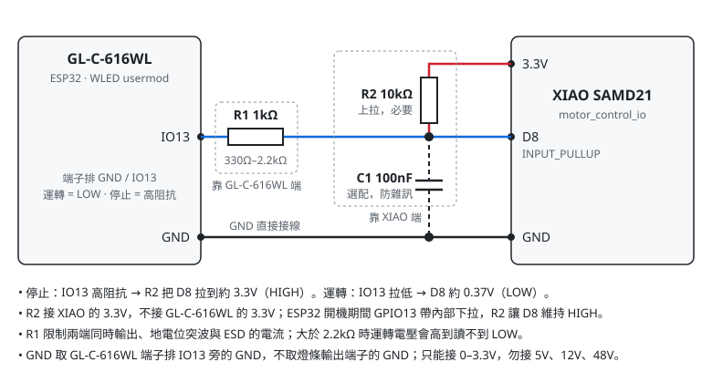

# Moon Observe motor control

Select **Seeeduino XIAO** (SAMD21) in Arduino IDE and open `motor_control_io.ino`. Set `TARGET_PWM_DUTY` in `board_config.h` to the duty established by `motor_pwm_test`. The current configured value is 82, with a compile-time range of 0–90. Zero disables motor start.

## D8 normal run/stop input

D8 uses `INPUT_PULLUP` and an external interrupt. Connect a dry contact or open-drain output between **D8 and GND**. Open/high requests normal stop; closed/low requests start. For an actively driven input, use a shared ground and a 0–3.3 V signal. Do not connect 5 V, 12 V, or 48 V directly to D8. D8 is also the SPI SCK pin, so do not use SPI on this pin at the same time.

In production D8 is driven by GL-C-616WL IO13 through the WLED usermod in `../../wled/` (Art-Net channel 469). Wire IO13 through 1 kΩ to D8, add an external 10 kΩ pull-up from D8 to the XIAO 3.3 V so D8 stays HIGH while the ESP32 boots, and connect the two GNDs directly. See the wiring section of `../../wled/README.md` for component placement and values.

At boot, D1 PWM, D2 pre-charge relay, and D3 main relay are initialized OFF. The motor stays OFF until D8 has been HIGH and then changes to LOW. A LOW held through boot does not start the motor. Changes are debounced for 30 ms. The interrupt only marks an input change; the main loop reads the pin and changes the motor state.

On a valid start, KPRE turns ON for 500 ms; KMAIN turns ON for 100 ms while KPRE remains ON; KPRE turns OFF for 100 ms; then PWM rises by 1 duty count every 120 ms to `TARGET_PWM_DUTY`. A HIGH command during pre-charge releases the relays immediately because PWM has not started.

On a valid stop during ramp or running, PWM falls by 1 duty count every 120 ms. KMAIN remains ON until PWM reaches zero and another 300 ms have elapsed, then turns OFF. With the configured duty of 82, a stop from full duty takes about 10.17 seconds including the 30 ms input debounce. A LOW received while stopping does not cancel the stop; after power is OFF, return D8 HIGH and then LOW to start again.

This is a normal controlled stop, not an emergency stop. The 300 ms wait does not confirm that the rotor has stopped; there is no stop feedback sensor. For long or noisy wiring, provide a suitable external pull-up, filtering, or isolation at the input.
