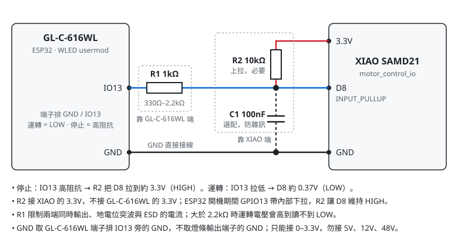

# WLED 馬達命令轉接（GL-C-616WL IO13 → SAMD21 D8）

以 WLED **v0.15.x** 為基礎（版本見 `WLED_VERSION`，必須與現場 GL-C-616WL 相同），加一個 usermod，把 backend 每包 Art-Net 的 **channel 469** 轉成 GL-C-616WL **IO13** 的數位訊號，接到 XIAO SAMD21 的 D8（`../sketches/motor_control_d8`）。這條路徑獨立於 WLED 的 LED 控制：WLED 的開關、亮度、preset、DMX 模式、segment、realtime timeout 都不影響馬達命令。backend 與 SAMD21 firmware 不需修改。

這不是緊急停止；停止後馬達照 SAMD21 的流程緩停（約 10 秒）。

## 目錄

- `WLED_VERSION`：pin 住的 WLED tag。
- `patches/0001-moon-motor-hook.patch`：核心只改兩處。`e131.cpp` 在 universe 與序號檢查之後、`switch (DMXMode)` 之前把 Art-Net 原始資料交給 usermod；`usermods_list.cpp` 註冊 usermod。
- `usermod_moon_motor/moon_motor_logic.h`：純判斷邏輯，host test 為 `../tests/moon_motor_logic_host.cpp`。
- `usermod_moon_motor/usermod_moon_motor.h`：WLED usermod（GPIO、網頁、設定）。
- `platformio_override.ini`：env `moon_eth`，繼承 WLED 的 `esp32_eth`，加 `-D USERMOD_MOON_MOTOR` 與 `-D WLED_ETH_DEFAULT=WLED_ETH_GLEDOPTO`（只在 `cfg.json` 沒有 `eth.type` 時生效，設定遺失後仍有網路）。
- `build.sh`：clone tag → 套 patch → 複製 usermod → `pio run`，輸出到 `dist/`（不進版控）。
- `flash.py`、`flash.bat`：一鍵刷機（見〈刷機〉），備份存在 `backups/`（不進版控）。測試為 `../tests/test_flash.py`。

## 輸出規則

IO13 以 open-drain 方式輸出：**運轉 = 輸出 LOW；停止 = 高阻抗**，由 D8 的 pull-up 拉成 HIGH。ESP32 重開機、OTA、當機時 IO13 都是高阻抗，因此一律是停止。

每次 `loop()` 由上往下判斷：

1. **OTA 開始後** → 停止，直到重開機（OTA 失敗也一樣）。
2. **禁止運轉開啟** → 停止。Art-Net 照樣記錄但不採用。
3. **1 秒內有收到 Art-Net**（第一個 universe、長度 ≥ 469）→ channel 469 為 255 時運轉，其他值停止。由停止轉為運轉需要連續 3 包 255（約 75 ms）；已在運轉中（手動運轉、剛解除禁止）收到 255 則直接接手，不中斷。
4. **手動運轉中且時間未到** → 運轉。
5. 其他情況 → 停止（開機後未收到 Art-Net，或 Art-Net 逾時）。

## 網頁操作

WLED 主頁的 **Info** 面板會顯示「馬達輸出」「Art-Net ch469」「禁止運轉」「手動運轉」四列，按鈕文字為英文，按下後面板會自動更新。

- **禁止運轉**：只存在 RAM，重開機後恢復為未禁止。按 **LOCK** 開啟，開啟時會取消進行中的手動運轉。解除要按兩次 **UNLOCK**：第一次按鈕顯示 `TAP AGAIN: UNLOCK`，5 秒內再按一次才送出。**若 Pi 目前命令為運轉，解除後馬達會立即啟動，按鈕上沒有另外提醒。** 不用 `confirm()`，因為 iOS 的 WLED App 不會顯示該視窗，按鈕會沒有反應。
- **手動運轉**：只在 1 秒內沒有收到 Art-Net 時可用。Pi 的 backend 即使馬達命令為 0 也一直在送封包，所以要先停止 `moon-observe` 服務或拔掉 Pi 端網路線。持續秒數在設定頁設定（預設 60 秒，範圍 10–600），按 **MOTOR ON 60s**（依設定秒數顯示）同樣要在 5 秒內按兩次。時間到、按 **MOTOR OFF**、開啟禁止運轉、收到任何 Art-Net、OTA、重開機都會結束手動運轉。

JSON API（`POST /json/state`）：

```json
{"moonMotor": {"inhibit": true}}
{"moonMotor": {"inhibit": false}}
{"moonMotor": {"manual": 60}}
{"moonMotor": {"manual": 0}}
```

`manual` 為秒數，會限制在 10–600；`0` 結束手動運轉。`GET /json/info` 的 `moonMotor` 物件提供 `output`、`reason`、`value`、`ageMs`、`inhibit`、`manualRemainingS`、`pin`。

設定頁 **Config → Usermods → MoonMotor**：`pin`（預設 13，`-1` 停用）、`timeoutMs`（預設 1000，範圍 200–10000）、`manualSeconds`（預設 60）。

## WLED 設定依賴

- **Sync Interfaces → Realtime**：類型為 Art-Net，universe 與 backend 的 target 一致（LED 本來就需要）。
- 其他 LED 相關設定（燈數、亮度、DMX mode、realtime timeout、「Receive UDP realtime」）都不影響馬達命令。
- IO13 由 usermod 佔用，WLED 不會再讓 LED、按鈕、IR 使用它。

## 接線



| 元件 | 值 | 位置 | 用途 |
|---|---|---|---|
| R1 | 1kΩ（330Ω–2.2kΩ） | IO13 與 D8 之間，靠 GL-C-616WL 端 | 限流保護：兩端同時輸出（D8 也是 SPI SCK）、地電位突波、ESD。功能上可省，但建議保留 |
| R2 | 10kΩ | D8 到 **XIAO 的 3.3V**，靠 XIAO 端 | **必要**。ESP32 重置到 usermod 接手前，GPIO13 帶內部下拉（約 45kΩ）；只靠 SAMD21 內建約 40kΩ 上拉時 D8 只有約 1.6V，WLED 重開機可能被讀成 LOW 而啟動馬達。加上 R2 後約 2.8V |
| C1 | 100nF | D8 到 GND，靠 XIAO 端 | 選配，濾除長線雜訊 |

- IO13 是 Gledopto 標示為 DIY 用的擴充 GPIO（端子排 `GND / IO13`），直接拉出 ESP32 的 GPIO13，0–3.3V。SAMD21 不耐 5V，D8 只能接 0–3.3V。
- 停止時 IO13 高阻抗，D8 約 3.3V；運轉時 IO13 拉低，D8 約 0.37V。R1 超過 2.2kΩ 時運轉電壓會接近 SAMD21 的 LOW 門檻（約 1V），不要再加大。
- R2 接 XIAO 的 3.3V，不接 GL-C-616WL 的 3.3V，XIAO 沒供電時兩板間不會倒灌電流。
- 12V 與 48V 已共地；GND 線仍直接接，取 GL-C-616WL 端子排 IO13 旁的 GND，不取燈條輸出端子的 GND。實測地偏移過大時改用光耦合器。

## 建置

需要 git、Node.js 與 PlatformIO（例如 `pipx install platformio`）。

```bash
firmware/wled/build.sh
```

輸出 `firmware/wled/dist/WLED_<版本>_moon_eth.bin`。可用 `WLED_VERSION` 暫時改用其他 tag、`WLED_WORK_DIR` 指定 WLED 原始碼目錄、`PIO` 指定 `pio` 路徑。patch 已確認可套用並編譯於 v0.15.3、v0.15.4、v0.15.5。

GL-C-616WL 使用 Ethernet type 13（Gledopto Series With Ethernet：PHY addr 1、power GPIO5、MDC GPIO23、MDIO GPIO33、clock GPIO0 輸入），WLED v0.15.4 起才有。`build.sh` 會拒絕沒有這個板型的版本，因為刷進去會失去網路。

## 刷機

### 一鍵刷機

需要 [uv](https://docs.astral.sh/uv/)，esptool 版本由腳本固定。先跑 `build.sh`，再雙擊 `flash.bat` 依提示操作，或在 `firmware/wled/` 執行：

```bash
uv run flash.py ota 192.168.1.50 192.168.1.51        # 第二台起，逐台 OTA
uv run flash.py usb --port COM3 --ip 192.168.1.50    # 第一台，或 OTA 失敗時
uv run flash.py usb --port COM3 --no-ip              # 救援：板子不在網路上，跳過刷機前後的網路檢查
uv run flash.py config 192.168.1.50                  # 不刷韌體，只寫入 unit_settings.json
```

USB 加 `--no-backup` 跳過 `full_flash.bin`（約 2 分鐘），仍會備份 JSON 並比對分割表；沒有 `full_flash.bin` 就無法還原原廠韌體，第一台不要用。加 `--check` 只跑檢查與備份，不寫入；`config --check` 另外列出會變更的設定。

現場設定放在 `unit_settings.json`：Art-Net port 6454、universe 0、Multi RGB、起始位址 1、一路輸出 IO16 共 129 顆、每顆 30 mA（WLED 的 12V 選項）、電流限制關閉。這些值不編進韌體，因為編譯預設值只在 `cfg.json` 沒有該值時生效，而刷機會保留 `cfg.json`。每次網路刷機後會自動寫入（一致時略過）：寫入 → 等 `/cfg.json` 讀回正確 → 重開機 → 再次比對。`--no-ip` 不會寫入，板子回到網路後要另外跑 `config`。

電流限制關閉後，WLED 不會壓低亮度，電源與保險絲要依燈條全亮的實際電流規劃。

腳本會自動做下面的手動步驟：

- 檢查 `release`、`ver`、`eth.type`、Ethernet 腳位；realtime 串流進行中或馬達運轉時拒絕刷機，要先停止 `moon-observe`。OTA 會在第一次寫入前檢查完所有板子。
- 備份 `info.json`、`cfg.json`、`presets.json` 到 `backups/<MAC>-<時間>/`。USB 另外比對分割表與 MAC，並備份整顆 flash 為 `full_flash.bin`。
- 顯示 bin 的 SHA256，輸入 `yes` 後才寫入（`--yes` 可略過）。
- 等板子重開機，確認 `moonMotor` 存在、輸出為停止、腳位為 13，Ethernet 設定未變；`presets.json` 或其他設定有變動時顯示警告。有一台失敗就停止，不刷後面的板子。

腳本不會送 `skipValidation`，也不會清除整顆 flash。`--no-ip` 只驗證寫入內容，刷完要自己看 Info 面板。

**`full_flash.bin` 含 Wi-Fi 等密碼，不要分享或加入版控。** 通過腳本的驗證不等於驗收，仍要跑下面的〈驗收〉。

### 手動步驟

每台刷機前：

1. 備份 `http://<WLED_IP>/json/info`、`/cfg.json`、`/presets.json`。
2. 確認 `/cfg.json` 的 `eth.type` 為 13、`pin` 為 `[21, 19, 22, 25, 26, 27, 5, 23, 33, 0]`，`/json/info` 的 `release` 為 `ESP32_Ethernet`，`ver` 與 `WLED_VERSION` 相同。不一致時先不要刷：Ethernet 設定錯誤會失去網路，只能接 UART 重刷。
3. 確認有 UART 燒錄的方法，第一台先用 `esptool read_flash` 備份原廠韌體。

刷機用 WLED 的 **Config → Security & Updates → Manual OTA Update** 上傳 bin。設定與 preset 會保留。刷完在 Info 面板確認出現「馬達輸出」列。

### USB 燒錄（第一台，或 OTA 失敗時）

Gledopto 的網頁燒錄工具只能燒它自己的韌體，這裡改用 esptool。**只寫 app 分割區，不清除整顆 flash**：設定（含 Ethernet type 13）存在 flash 的檔案系統裡，整顆清除後會失去網路設定。

```bash
esptool() { uvx --from esptool==4.8.1 esptool.py "$@"; }   # uv 自動下載並快取；bash、zsh 都適用
PORT=/dev/cu.usbserial-XXXX     # 插上 USB 前後各跑一次 ls /dev/cu.* 找出來

esptool --port $PORT flash_id                                   # 確認 ESP32、4MB
esptool --port $PORT --baud 460800 read_flash 0 0x400000 unit1_full_backup.bin
esptool --port $PORT --baud 460800 read_flash 0x8000 0xC00 unit1_partitions.bin
cmp unit1_partitions.bin firmware/wled/dist/partitions_reference.bin && echo SAME
```

只有分割表相同（`SAME`）才繼續；不同時先停下來，app0 的位置可能不一樣。

```bash
esptool --port $PORT --baud 460800 write_flash 0x10000 firmware/wled/dist/WLED_v0.15.4_moon_eth.bin
esptool --port $PORT erase_region 0xe000 0x2000
```

`erase_region` 清掉 otadata，讓開機一定從 app0 啟動；原廠韌體若曾透過 OTA 更新過，可能正從 app1 開機，只寫 app0 會沒有效果。完成後 esptool 會重開板子。

還原原廠：`esptool --port $PORT --baud 460800 write_flash 0 unit1_full_backup.bin`。

## 驗收

先不接馬達。IO13 不會輸出 HIGH，觀察用 LED 要接成 3.3V →1kΩ→ LED 陽極、陰極 → IO13（運轉亮、停止滅）；接 IO13 → GND 永遠不亮。萬用表則在 IO13 與 3.3V 之間接 10kΩ 後量（運轉約 0V，停止約 3.3V）：

- [ ] Pi `PUT /api/motor` `{"enabled":true}` → 約 75 ms 內運轉；`false` → 停止
- [ ] WLED 關燈、亮度 0、切換 preset、改 LED 設定時輸出不變
- [ ] `systemctl stop moon-observe` → 立即停止（backend 正常退出會送一包 0）
- [ ] `kill -9` backend、拔網路線 → 約 1 秒內停止
- [ ] 送到其他 universe、或 ArtDmx 長度小於 469 → 不影響
- [ ] 禁止運轉：開啟即停止；Pi 命令為運轉時解除要按兩次，第二次後立即運轉；重開機後恢復為未禁止
- [ ] 兩段式按鈕在 iOS WLED App 與電腦瀏覽器都可用；只按一次時 5 秒後恢復，不送出命令
- [ ] 手動運轉：Pi 在送封包時無法使用；停止 Pi 後可運轉並在設定秒數後停止；期間 Pi 恢復且命令為 255 時持續運轉、為 0 時停止
- [ ] WLED 重開機、OTA 開始 → 停止，開機期間 D8 維持 HIGH

接上 `motor_control_d8` 後，先只接 relay 確認啟停順序與緩停，再接馬達，並量 GL-C-616WL 與 XIAO 之間的地偏移。

## 注意

- WLED 的 JSON API 沒有驗證，設定 PIN 只保護設定頁。Pi 沒有送 Art-Net 時，區網上任何人都能以手動運轉啟動馬達；現場網路需與其他網路隔離。
- 不要把 `moonMotor` 寫進 WLED preset 或 playlist；套用 preset 也會執行這些命令。usermod 不輸出 state，所以從網頁儲存的 preset 不會帶到它。
- 升級 WLED 時必須重新核對 patch 的插入位置與 usermod API（新版 WLED 的 usermod 註冊方式不同），並重跑上面的驗收。
